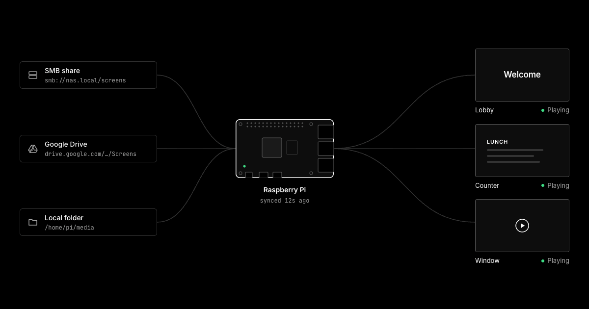

# Pi Display

<a href="https://pi-display-five.vercel.app"></a>

Turns a Raspberry Pi into a full-screen slideshow of every image and video in a folder, played in filename order. The folder can be local, on an SMB share, or a public Google Drive folder. The Pi boots straight into the slideshow whenever it gets power.

**Start at [pi-display-five.vercel.app](https://pi-display-five.vercel.app).** The [install page](https://pi-display-five.vercel.app/install) builds a one-line setup command for your folder, the [config generator](https://pi-display-five.vercel.app/config) builds a `display.toml`, and the [docs](https://pi-display-five.vercel.app/docs) cover everything below in more detail.

## Getting started

### 1. Prepare the Pi

Flash an SD card with [Raspberry Pi Imager](https://www.raspberrypi.com/software/):

- **OS:** Raspberry Pi OS Lite (64-bit), Trixie or newer. Use the 32-bit Lite image only on a Pi older than a Pi 3 or Zero 2 W.
- **Customisation:** set a username and password, Wi-Fi if you are not on Ethernet, your timezone, and turn on SSH.

Plug the Pi into the display, boot it, and SSH in as the user you created.

### 2. Download Pi Display

```sh
curl -fsSLo pi-display "https://github.com/maks112v/pi-display/releases/latest/download/pi-display-$(dpkg --print-architecture)"
chmod +x pi-display
```

This picks the right build for your OS (`arm64` or `armhf`). Every release is listed on the [releases page](https://github.com/maks112v/pi-display/releases).

### 3. Run setup

```sh
sudo ./pi-display setup
```

Run it with `sudo` from your normal user, not as root. The slideshow runs as that user. Setup:

1. Asks for the media folder. Any of these work:
   - SMB share: `smb://nas.local/share/path`. You are then asked for a username (blank for guest) and password.
   - Public Google Drive folder: `https://drive.google.com/drive/folders/...`. No sign-in, but the folder must be shared as "Anyone with the link".
   - Local folder: an absolute path like `/home/pi/media`.
2. Connects and reports how many images and videos it found. A wrong link or password stops setup here.
3. Installs mpv if it is missing.
4. Installs itself to `/usr/local/bin/pi-display` and adds a service that starts the slideshow on every boot. You can delete the downloaded `./pi-display` afterwards.
5. If the Pi boots to a desktop, offers to boot to console instead. Say yes: the slideshow needs the screen to itself.
6. If the Pi has the boot splash (the desktop image does), sets the boot logo to the Pi Display icon. On Raspberry Pi OS Lite this step is skipped.

To skip the questions, use the install page on the website and run the command it gives you: `sudo ./pi-display setup <code>`. The code carries the folder and login, and setup turns the desktop off at boot without asking. It includes the password encoded, not encrypted, so treat it like the password.

The slideshow starts as soon as setup finishes, and again whenever the Pi gets power. Re-run `sudo pi-display setup` any time to point it at a different folder. Re-running keeps the slideshow settings already on the Pi.

### 4. Add media

Put images and videos in the folder. New files show up within about 30 seconds. To change timing, add a [`display.toml`](#displaytoml) to the same folder. The config generator on the website builds one for you.

## Day to day

```sh
pi-display status            # version, source, service health, and whether the screen is on
pi-display logs              # watch the logs (journalctl -u pi-display -f)
pi-display version           # show the installed release
sudo pi-display update       # install the latest release, keeping your settings
sudo pi-display config <code> # apply slideshow settings from the config generator to this Pi only
sudo pi-display uninstall    # remove Pi Display and everything setup added
pi-display on 2h             # screen on for 2 hours, whatever the schedule says (see below)
pi-display off 2h            # screen and TV off for 2 hours
sudo pi-display start        # restart the slideshow, after the console or desktop
sudo pi-display desktop      # stop the slideshow and start the desktop until reboot
```

`update` downloads the build for your Pi, checks it against the release's `SHA256SUMS`, swaps it in, and restarts the slideshow.

With an SMB folder, each screen also appends its log to `<hostname>.pi-display.log` in that folder after every sync, so you can check every screen from the share without SSH. Lines logged while the share is unreachable are held (up to 500) and written once it is back. The file starts over after 1 MB. Players never show `.log` files. The login needs write access to the folder; with a read-only login the logs stay in journald only.

## Releasing

Push a version tag. GitHub Actions runs the tests, builds `arm64` and `armhf` binaries, and publishes a release with checksums.

```sh
git tag v0.1.0
git push origin v0.1.0
```

To build from source instead: `GOOS=linux GOARCH=arm64 CGO_ENABLED=0 go build -o pi-display .`

## How it works

- SMB and Drive folders are mirrored into `/var/lib/pi-display/media` every 30 seconds. Playback runs from that copy, so the slideshow starts at boot before the network is up and keeps going if the source goes offline. Make sure the SD card has room for the whole folder. A file that would leave less than 256 MB free is skipped and logged instead of filling the card; the rest of the folder keeps syncing.
- Drive is read through its public folder view and download links, not the API, so Google can break it by changing those pages. Native Google Docs are ignored. If two files share a name, the first one listed wins.
- Only files at the top level of the folder are used. Subfolders and hidden files are ignored.
- Order is natural filename order: `2.jpg` plays before `10.jpg`. With `shuffle = true`, every file plays once per loop in a new random order each time, and the last file of one loop never plays first in the next.
- The folder and `display.toml` are re-read before every file, so changes show up within one slide (plus up to 30 seconds of sync).
- mpv does the decoding and draws straight to the screen with hardware decoding. `pi-display` decides what plays and for how long.

Images: jpg, jpeg, png, webp, bmp, gif. Videos: mp4, m4v, mov, mkv, webm, avi. Videos play once through, then the slideshow moves on.

## display.toml

Drop an optional `display.toml` into the folder:

```toml
image_seconds = 10   # how long each image shows (default 10)
mute = true          # mute video audio (default true)
fit = "contain"      # "contain" letterboxes, "cover" fills and crops (default "contain")
shuffle = false      # random order, reshuffled every time the folder loops (default false)
tv_power = true      # turn the TV off and on with the schedule over HDMI-CEC (default true)

# Per-image overrides, in seconds
[durations]
"intro.jpg" = 30

# Daily on/off times in the Pi's local time, 24-hour HH:MM (default: always on).
# An off time earlier than the on time runs past midnight.
[schedule]
on = "07:00"
off = "22:00"
```

Or set hours per weekday instead of `on`/`off`. Days left out stay off, and a day can have several windows:

```toml
[schedule]
sun = ["09:00-18:00"]
fri = ["07:00-12:00", "17:00-22:00"]
```

The file is parsed strictly. If it has an unknown key, a wrong type, or a value out of range, the whole file is ignored, the last good settings stay in effect, and the error is logged. Nothing in it is passed to mpv as raw options.

If the Pi was set up with a setup code, its slideshow settings are the starting point and `display.toml` overrides only the keys it sets. `[durations]` entries are added to the ones from the code.

## Turning the screen on or off

Outside the schedule the screen shows black, and with `tv_power` (on by default) the Pi puts the TV in standby over HDMI-CEC and wakes it when the schedule comes back. The TV needs CEC turned on in its settings, often under a brand name like Anynet+, Bravia Sync, or SimpLink. Set `tv_power = false` to leave the TV alone.

To override the schedule for a while, SSH in and run:

```sh
pi-display on        # on for 1 hour
pi-display on 3h30m  # on for any duration
pi-display off 2h    # off for any duration, TV in standby
pi-display on 0      # cancel either and go back to the schedule
```

`on` also wakes a TV someone turned off with the remote, and `off` works with or without a schedule. A new command replaces the last one, takes effect at the next slide, and survives a reboot. Schedule changes and expired overrides take effect at the next slide. Set the Pi's timezone with `sudo raspi-config` so the schedule matches the wall clock.

## Fixing a Pi on site

If the Pi moves to a new building or the Wi-Fi changes, plug a keyboard into it and press **Ctrl+Alt+T**. The slideshow stops and the screen shows the console login. Log in with the Pi's account, then change Wi-Fi with `sudo raspi-config` (System Options, Wireless LAN). Ctrl+Alt+F1 through F12 work too.

If the Pi has the desktop installed, `sudo pi-display desktop` starts it until the next reboot, for changing settings with a mouse.

`sudo pi-display start` or a reboot brings the slideshow back. Media already on the Pi keeps working offline, so the slideshow plays the last synced copy until the network is back.

## Files on the Pi

| Path | What |
| --- | --- |
| `/etc/pi-display/config.json` | Source and SMB credentials (0600) |
| `/usr/local/bin/pi-display` | Installed binary |
| `/etc/systemd/system/pi-display.service` | Boot service |
| `/var/lib/pi-display/media` | Mirrored SMB or Drive files |
| `/var/lib/pi-display/override` | A `pi-display on` or `off` override and when it ends |
| `/usr/share/plymouth/themes/pi-display` | Boot logo theme, if Plymouth is installed |

## License

[PolyForm Shield 1.0.0](LICENSE.md). You can use and change Pi Display for anything, including running it on your business's own screens. You can't sell it or offer a product that competes with it, paid or free.
